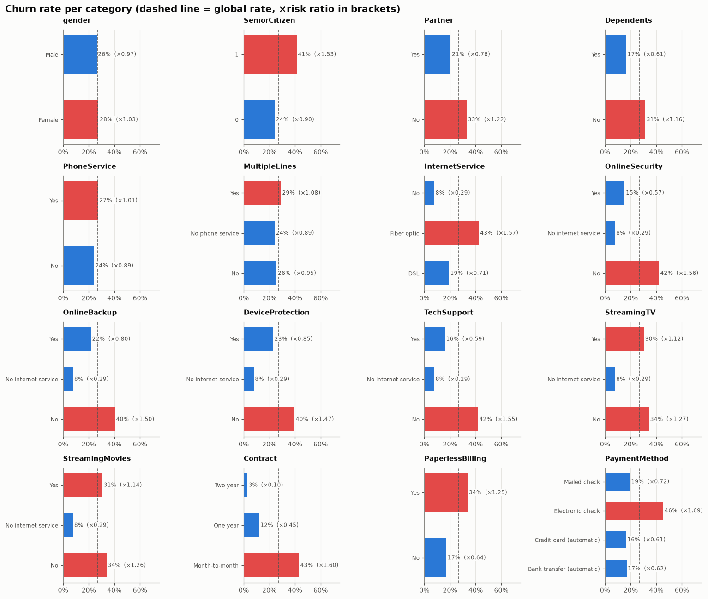
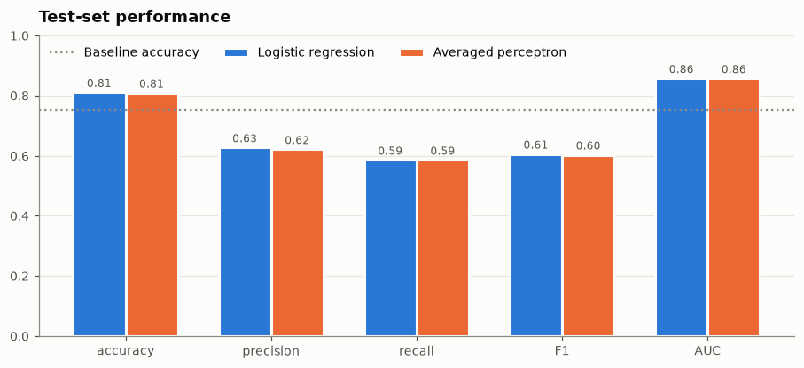
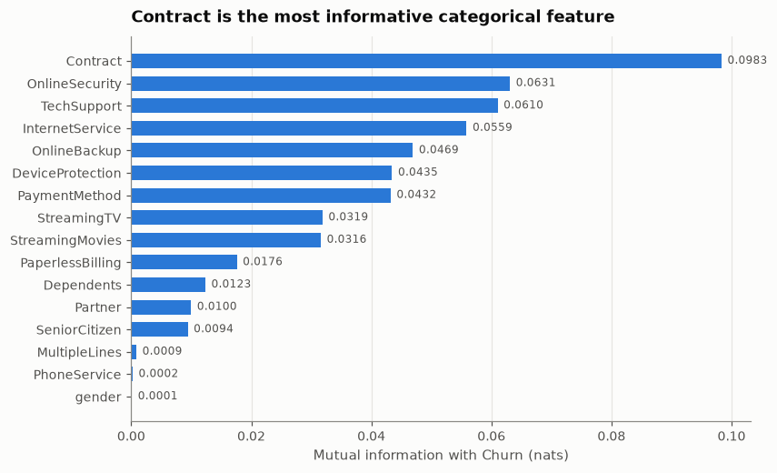
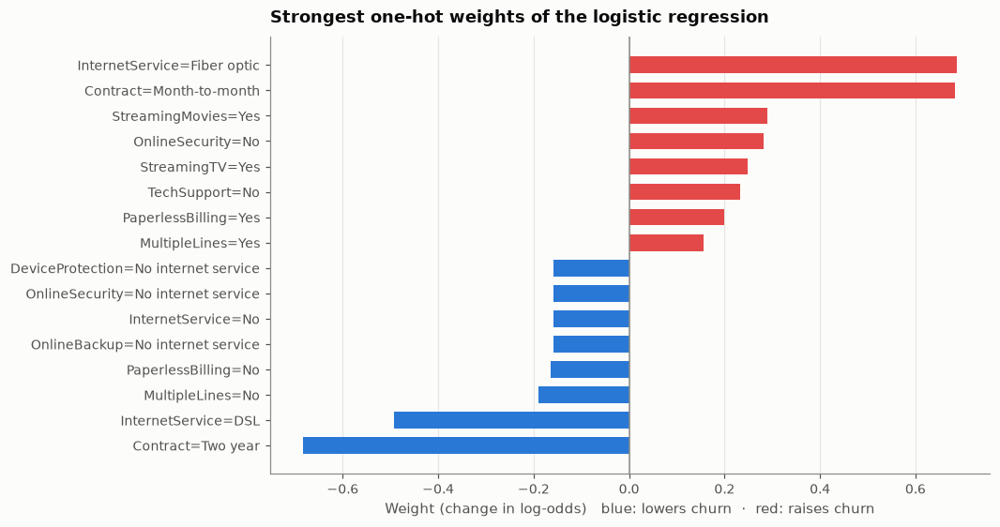
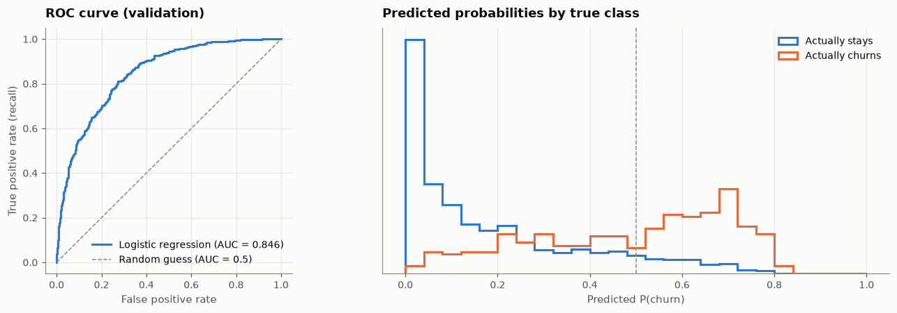
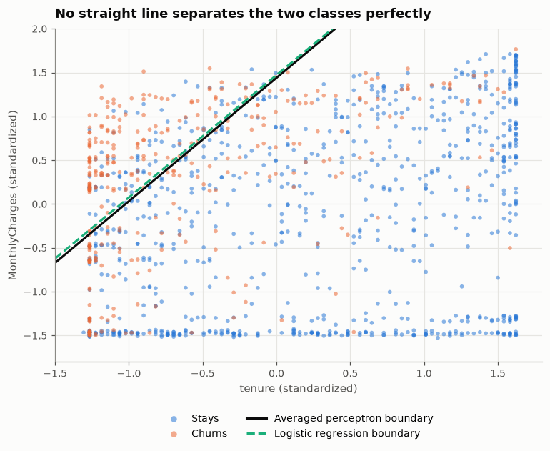
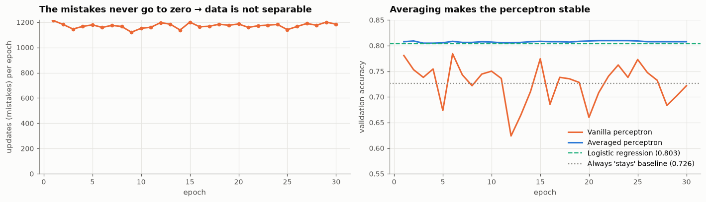

# 📉 Customer Churn Prediction: A Binary Classification Tutorial


A complete, beginner-friendly machine-learning project that predicts which customers of a telecom company are about to **churn** (cancel their contract). Every step is explained with **intuition, math, code, and visualizations**: from cleaning the raw data to training and interpreting a **logistic regression**, and implementing **Rosenblatt's perceptron from scratch**.

> 👉 **Start here:** [`churn_prediction.ipynb`](churn_prediction.ipynb)

<p align="center">
  
</p>

---

## 📚 What you will learn

| # | Topic | Highlights |
|---|-------|------------|
| 1–4 | **Data preparation** | Fixing wrong data types, why `TotalCharges` has blanks (spoiler: new customers), encoding the target |
| 5 | **Train / validation / test split** | Why 60/20/20, and why the second split uses `test_size=0.25` |
| 6 | **Exploratory data analysis** | Churn rate, **difference** and **risk ratio** per category |
| 7 | **Mutual information** | Entropy, $I(X;Y)$, an implementation from scratch checked against scikit-learn |
| 8 | **Correlation** | Pearson's $r$, point-biserial correlation, collinearity |
| 9 | **One-hot encoding** | `DictVectorizer` vs. `OneHotEncoder` + `ColumnTransformer`: which one, and when? |
| 10 | **Logistic regression** | Sigmoid, log-odds, log loss & its gradient, interpreting weights as odds multipliers |
| 11 | **Evaluation** | Confusion matrix, precision, recall, F1, threshold tuning, ROC & AUC |
| 12 | **Using the model** | Retraining on train + validation, testing, a ranked retention campaign, scoring one customer |
| 13 | **The perceptron** | Update rule, its link to gradient descent, Novikoff's convergence theorem, the **averaged perceptron** |
| 14 | **Final comparison** | Logistic regression vs. perceptron on the held-out test set |

## 📊 Results

All models are evaluated on a **held-out test set** (20 % of the data, 1,409 customers) that was not used for any modeling decision.

| Model | Accuracy | Precision | Recall | F1 | ROC AUC |
|-------|:--------:|:---------:|:------:|:--:|:-------:|
| Baseline (always predict "stays") | 0.753 | 0.000 | 0.000 | 0.000 | 0.500 |
| **Logistic regression** | **0.812** | 0.628 | 0.586 | 0.606 | **0.858** |
| Averaged perceptron (from scratch) | 0.810 | 0.622 | 0.586 | 0.604 | **0.858** |

<p align="center">
  
</p>

**Main drivers of churn:** month-to-month contracts, short tenure, fiber-optic internet, electronic-check payments, and no online security or tech support.

## 🖼️ A few figures from the notebook

| Mutual information of categorical features | Logistic regression weights |
|:---:|:---:|
|  |  |
| **ROC curve & predicted probabilities** | **Perceptron vs. logistic regression in 2-D** |
|  |  |

**Why do we need the *averaged* perceptron?** The churn data is not linearly separable, so the classic perceptron never stops updating, and its accuracy jumps from epoch to epoch. Averaging all intermediate weight vectors makes it stable:

<p align="center">
  
</p>

## 🗂️ Project structure

```
.
├── churn_prediction.ipynb   # The tutorial notebook (executed, with all outputs)
├── data/
│   └── churn_telco_data.csv # Telco Customer Churn dataset (7,043 customers × 21 columns)
├── images/                  # Figures used in this README
├── requirements.txt
├── LICENSE
└── README.md
```

## 🚀 Getting started

```bash
# 1. Clone the repository
git clone https://github.com/s110m/churn-prediction-binary-classification.git
cd churn-prediction-binary-classification

# 2. Create and activate a virtual environment
python -m venv .venv
source .venv/bin/activate        # Windows: .venv\Scripts\activate

# 3. Install the dependencies
pip install -r requirements.txt

# 4. Launch Jupyter and open churn_prediction.ipynb
jupyter notebook
```

The notebook runs from top to bottom in under a minute on a laptop. All random operations use a fixed seed, so you will get the same numbers as shown here.

## 📦 Dataset

The **[Telco Customer Churn](https://www.kaggle.com/datasets/blastchar/telco-customer-churn)** dataset was originally published by IBM as a sample dataset and is distributed on Kaggle. Each of the 7,043 rows is one customer, described by:

- **Demographics:** gender, senior citizen, partner, dependents
- **Account information:** tenure, contract, paperless billing, payment method, monthly and total charges
- **Services:** phone, multiple lines, internet, online security, online backup, device protection, tech support, streaming TV and movies
- **Target:** `Churn`, whether the customer left within the last month (`Yes` / `No`)

To download a fresh copy, see the (commented) [`kagglehub`](https://github.com/Kaggle/kagglehub) cell at the beginning of the notebook.

## 🔭 Ideas for further work

- Hyper-parameter tuning (e.g. the regularization strength `C`) with cross-validation
- Choosing the decision threshold from a business cost matrix
- Tree-based models: random forests, gradient boosting (XGBoost / LightGBM)
- Feature engineering: tenure buckets, number of add-on services
- From perceptron to a small neural network (`MLPClassifier`)

## 📄 License

The code in this repository is released under the [MIT License](LICENSE). The dataset belongs to its original authors (IBM); see the Kaggle page for its terms.

---

*If this tutorial helped you, please consider giving it a ⭐!*
